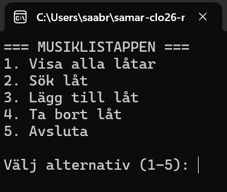

# Musiklistappen — [Ditt namn]

> **Instruktion till dig:** den här filen är *din* README. Ersätt all text i hakparenteser med din egen, och ta bort den här rutan när du är klar. Uppgiften och kraven står i [`UPPGIFT.md`](UPPGIFT.md), och inlämningen beskrivs i [`INLAMNING.md`](INLAMNING.md).

---

## Vad appen gör

Appen handlar om rapparen 2Pac. Man kan se hans låtar, lägga till nya låtar och ta bort låtar.

## Så kör du den

```bash
git clone https://github.com/SamarCumarHussein/samar-clo26-musiklistappen.git
cd samar-clo26-musiklistappen
dotnet run
```


## Så ser huvudmenyn ut


---


